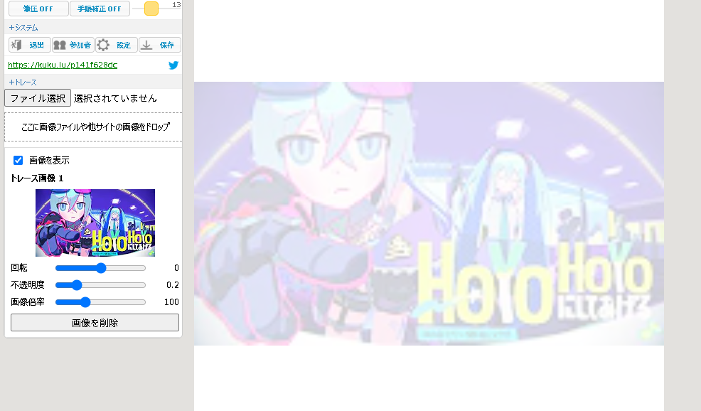

# 概要
このユーザースクリプトは、 [MagicalDraw](https://draw.kuku.lu/) で簡単にトレースするための拡張機能です。
これにより、画像を保存せずに`pixiv`などから画像をドラッグすることで簡単にトレースできます。

# 機能
1. **トレース機能**
   - `ファイル選択` 保存してある画像をトレースできます
   - `画像ドロップ` 画像を保存せずに、`pixiv`などから画像を`ここに画像ファイルや他サイトの画像をドロップ`にドラッグすることでトレースができます(PCのみ）
   - `画像編集` スライダーでトレース画像を編集でき、またトレース画像をドラッグすることで位置を変更できます。
   - `素材生成` canvas/video要素上で1秒間の`mousedown`か`ctrl + click`することでYouTubeなどの動画を画像として扱ってドラッグすることができます。
2. **スポイト機能**
   - 拡張機能メニューで実行でき、`Pick Color` をクリックすることでスポイト機能を使えます。コピーする値は`#`を抜いた16進数カラーコードです。
# インストール
1. **Tampermonkey をインストールする**  
   - Chrome : [Tampermonkey](https://chromewebstore.google.com/detail/tampermonkey-%E3%83%99%E3%83%BC%E3%82%BF%E7%89%88/gcalenpjmijncebpfijmoaglllgpjagf)
   - Firefox : [Tampermonkey](https://addons.mozilla.org/ja/firefox/addon/tampermonkey/)

2. **ユーザースクリプトを許可する**  
   拡張機能の管理で「ユーザースクリプトを許可」してください。詳しくは公式 [FAQ](https://www.tampermonkey.net/faq.php?locale=ja&q=Q209) を参照してください。  

3. **MagicalDraw-Tracer をインストール**    
   [ここ](https://github.com/grmpnk/MagicalDraw-Tracer/raw/refs/heads/main/userscript.user.js) から インストールできます。
